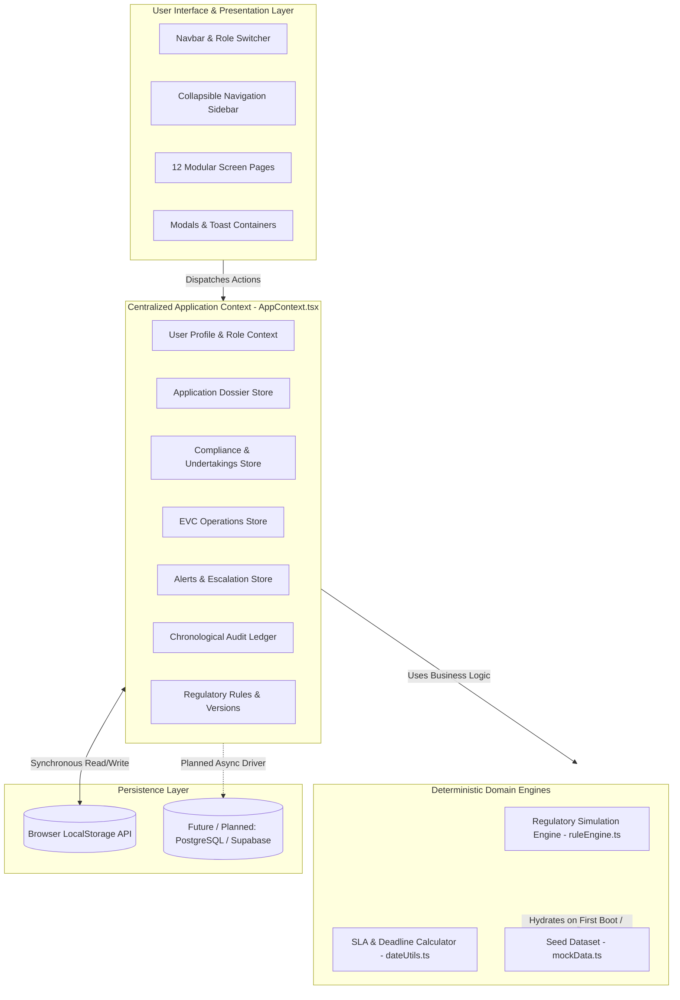
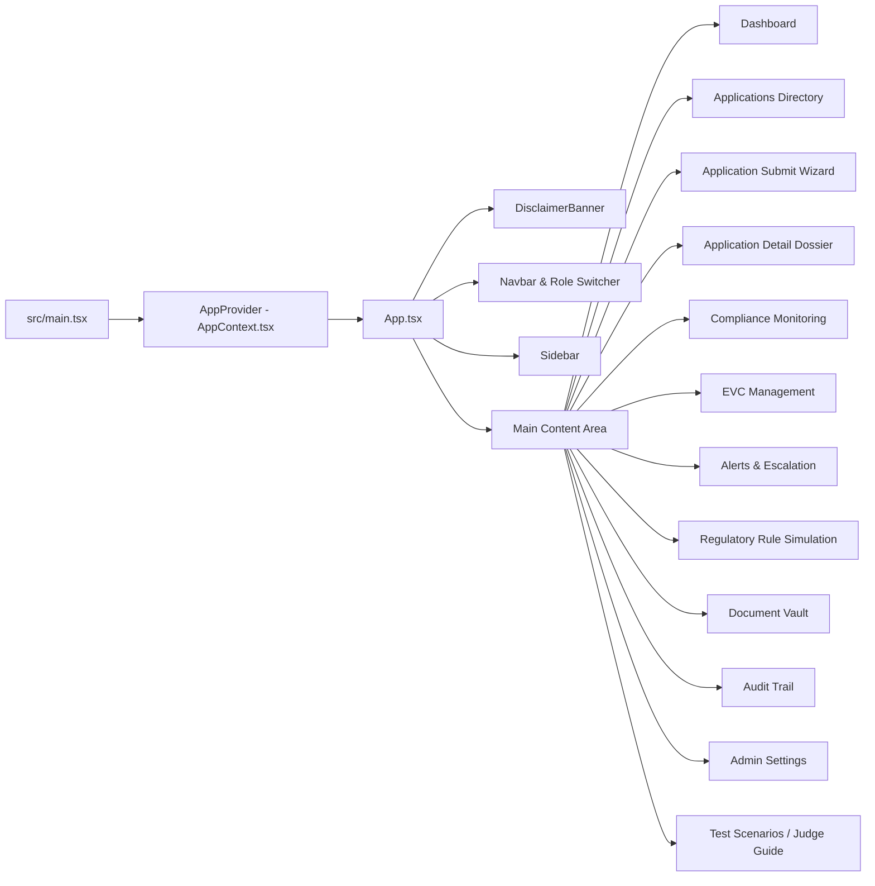
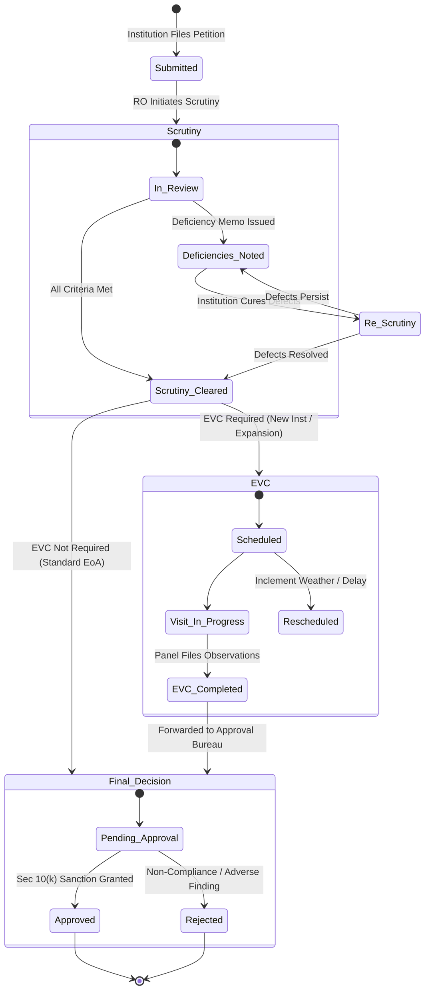
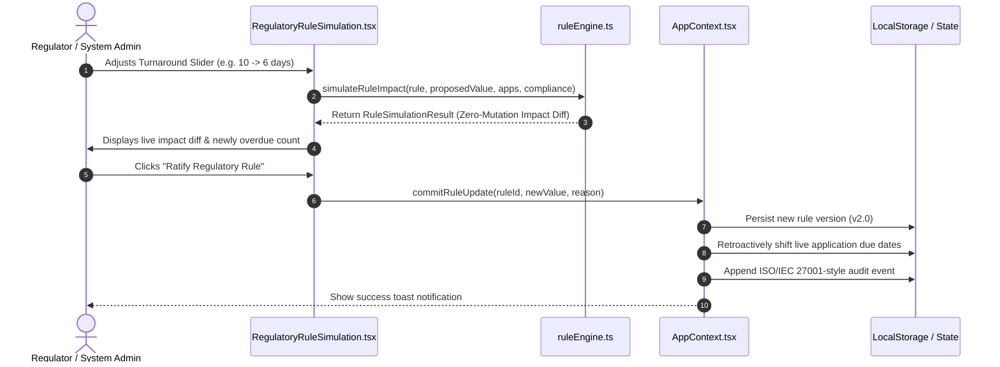
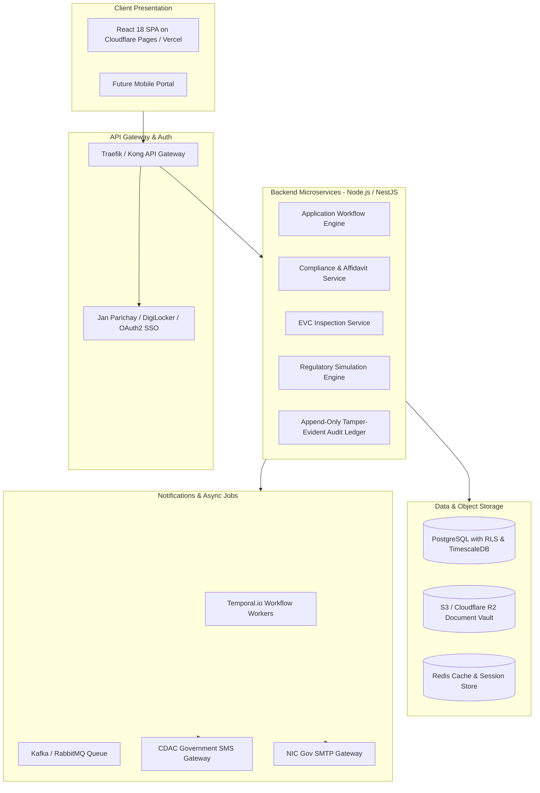

# 🏛️ System Architecture — CATALYST (PRAVAHA)

This document provides a comprehensive technical breakdown of the software architecture, component relationships, state management, and data flow of **CATALYST**.

---

## 1. High-Level Architecture Overview

CATALYST is currently built as a high-performance **Client-Side Single Page Application (SPA)** utilizing React 18, TypeScript, and Tailwind CSS, bundled with Vite. State and domain mutations are managed centrally through the React Context API (`AppContext`), with seamless persistence to the browser's `localStorage`.

---

## 2. Component Hierarchy & Navigation Flow

The root entry point is [src/main.tsx](file:///c:/Users/Vaibhav/Documents/antigravity/prot-sih/src/main.tsx), which mounts [src/App.tsx](file:///c:/Users/Vaibhav/Documents/antigravity/prot-sih/src/App.tsx) wrapped with `AppProvider`.

Instead of external heavy routing libraries, the prototype uses an internal, fast, deterministic navigation state (`currentPage`, `selectedAppId`, `appFilters`). This avoids client-side router 404 issues on static hosting and facilitates deep state passing between dashboard cards and filtered views.

---

## 3. Approval Workflow State Machine

The approval process adheres to the statutory requirements of the **AICTE Approval Process Handbook (APH)**. The lifecycle of an institutional petition follows a strict state transition graph:

### Transition Guardrails & Roles:
- **`Institution User`**: Can initiate submission (`Submitted`) and re-submit compliance evidence.
- **`Regional Officer`**: Authorized to progress petitions through `Scrutiny`, flag deficiencies, recommend `EVC`, or advance standard petitions.
- **`EVC Committee Member`**: Authorized to schedule visits, document observations, and record completion reports.
- **`Competent Authority`**: Sole statutory authority permitted to execute `Approved` or `Rejected` sanction orders under Section 10(k).
- **`System Administrator`**: Holds supervisory override permissions across all stages.

---

## 4. Regulatory Rule Simulation & Escalation Engine

The flagship SIH innovation is implemented in [src/utils/ruleEngine.ts](file:///c:/Users/Vaibhav/Documents/antigravity/prot-sih/src/utils/ruleEngine.ts).

### How the Digital Twin Works:
1. **Zero-Mutation Analysis:** When an official adjusts a slider (e.g. changing `scrutiny_window_days` from 10 to 6 days), the engine clones the active application list in memory.
2. **Deterministic Time-Shift:** For each application in `Scrutiny` or `Re-Scrutiny`, the engine calculates:
   $$\text{DaysDiff} = \text{ProposedValue} - \text{CurrentValue}$$
   $$\text{SimulatedDueDate} = \text{CurrentDueDate} + (\text{DaysDiff} \times 24 \times 60 \times 60 \times 1000)$$
3. **Overdue & Escalation Comparison:** Compares `SimulatedDueDate` against `REFERENCE_DATE` (`2026-10-30T21:10:49+05:30`):
   - Overdue Days $\ge 5 \implies$ **Escalation Level 3 (Competent Authority)**
   - Overdue Days $\ge 3 \implies$ **Escalation Level 2 (Bureau Head)**
   - Overdue Days $> 0 \implies$ **Escalation Level 1 (Regional Officer)**
4. **Summary & Diff Generation:** Emits a `RuleSimulationResult` containing:
   - `impactedApplications`: Line-by-line before/after due dates and escalation tier changes.
   - `newOverdueCount`: Net increase in non-compliant breaches.
   - `summaryExplanation`: Natural language summary for non-technical leadership.
5. **Ratification Action:** When ratified, `commitRuleUpdate()` increments the rule version (v1 ➔ v2), updates active applications, and writes an immutable audit record.

---

## 5. Technology Stack & Key Dependencies

| Layer | Technology | Version | Purpose in CATALYST |
| :--- | :--- | :--- | :--- |
| **Runtime & Language** | Node.js | $\ge$ 18.0.0 LTS | JavaScript runtime for development and tooling |
| **Language** | TypeScript | `^5.7.3` | Strict static typing across all entities, props, and actions |
| **UI Framework** | React | `^18.3.1` | Component-based interactive UI with concurrent features |
| **DOM Renderer** | React DOM | `^18.3.1` | Browser DOM rendering engine |
| **Bundler & Dev Server** | Vite | `^6.1.0` | Ultra-fast HMR and optimized Rollup production bundler |
| **Styling** | Tailwind CSS | `^3.4.17` | Utility-first styling with custom AICTE color palette |
| **CSS Processing** | PostCSS / Autoprefixer | `^8.5.1` / `^10.4.20` | CSS parsing and vendor prefix injection |
| **Icons** | Lucide React | `^1.16.0` | Crisp SVG icon library across navigation and badges |
| **Utility Classes** | clsx & tailwind-merge | `^2.1.1` / `^2.6.0` | Dynamic classname merging and conflict resolution |
| **State & Persistence** | React Context + LocalStorage | Native | Zero-backend state management and persistence |

---

## 6. Target Production Architecture (Future Roadmap)

While the hackathon prototype operates client-side for zero-friction evaluation, the underlying data models and interfaces are designed to transition smoothly to a distributed cloud architecture:

