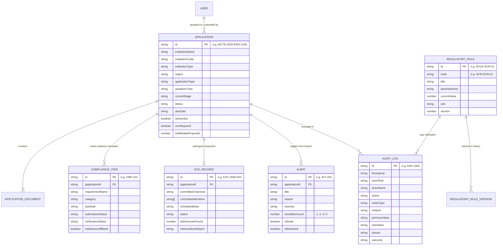

# 🗄️ Database & Data Architecture — CATALYST (PRAVAHA)

This document details the data architecture, entity relationships, client-side persistence mechanisms, seed datasets, and the planned migration schema for PostgreSQL.

---

## 1. Current Storage Model: Browser LocalStorage

In the current prototype, all data persistence is handled client-side via the Web Storage API (`localStorage`). This architecture eliminates database dependencies during demonstrations and hackathon evaluations.

### LocalStorage Keys & Data Payloads

All state is serialized as JSON strings in the following keys:

| Storage Key | TypeScript Type | Description |
| :--- | :--- | :--- |
| `catalyst_user` | `UserProfile` | Active user persona (ID, name, email, role, region, avatar). Defaults to *Er. Sunita Mukherjee (Regional Officer)*. |
| `catalyst_applications` | `Application[]` | Complete institutional petition dossiers, stages, statuses, documents, and SLA deadlines. |
| `catalyst_compliance` | `ComplianceItem[]` | Mandatory undertakings, land deeds, fire NOCs, and affidavit verification records. |
| `catalyst_evc` | `EVCRecord[]` | Expert Visiting Committee rosters, proposed/actual dates, checklist verifications, and inspection reports. |
| `catalyst_alerts` | `Alert[]` | SLA breach alerts with root-cause explanations and escalation tiers (Level 1, 2, 3). |
| `catalyst_audit` | `AuditLogEvent[]` | Chronological, append-only log capturing user actions, timestamps, and entity diffs. |
| `catalyst_rules` | `RegulatoryRule[]` | Active regulatory parameters (e.g. Scrutiny turnaround days, EVC scheduling window). |
| `catalyst_rule_history` | `RegulatoryRule[]` | Historical versions of ratified regulatory rules. |

---

## 2. Entity-Relationship Model

The following diagram illustrates the relationships between the core domain entities defined in [src/types/index.ts](file:///c:/Users/Vaibhav/Documents/antigravity/prot-sih/src/types/index.ts):



---

## 3. Seed Dataset Overview

The seed dataset is defined in [src/types/mockData.ts](file:///c:/Users/Vaibhav/Documents/antigravity/prot-sih/src/types/mockData.ts). It contains realistic records modeling the Indian technical education ecosystem:

- **6 User Personas:**
  - 1 Institution Principal (`Dr. Rameshwar Sharma`)
  - 2 Regional Officers (`Er. Sunita Mukherjee` - Eastern Region, `Dr. Anand Deshmukh` - Western Region)
  - 1 EVC Chairman (`Prof. K. Venkatesh, Retd. IIT`)
  - 1 Member Secretary / Competent Authority (`Prof. Manju Singh`)
  - 1 System Administrator (`Catalyst Admin`)
- **8 Representative Applications:**
  - Spread across `Submitted`, `Scrutiny`, `Re-Scrutiny`, `EVC`, and `Final Decision` stages.
  - Covers Extension of Approval (EoA), New Technical Institutions, and Intake Expansion.
  - Realistic program offerings: B.Tech Computer Science, Artificial Intelligence & Machine Learning, Robotics, MBA, MCA.
- **10 Compliance Items:**
  - Land title deeds, Fire NOCs, anti-ragging affidavits, building safety certificates.
- **6 EVC Inspection Records:**
  - Includes upcoming scheduled inspections, completed visits with clean remarks, and visits flagged with deficiencies.
- **8 High-Priority SLA Alerts:**
  - Concrete examples of Level 1 (RO), Level 2 (Bureau Head), and Level 3 (Competent Authority) overdue triggers.
- **Initial Regulatory Rules:**
  - `SCR-DUR-01`: RO Scrutiny window (10 days).
  - `RE-SCR-02`: Deficiency cure window (7 days).
  - `EVC-SCH-03`: EVC scheduling limit (14 days).

---

## 4. Reset & Backup Procedures

### Resetting to Pristine Demonstration Data:
To restore all state to default factory seed records:
1. In the UI, click the **Reset Data** button with the refresh icon located in the top navigation bar.
2. Alternatively, open **Settings** (`/settings`) and click **Reset Demo Data**.
3. Under the hood, `resetDemoData()` in `AppContext.tsx` clears the corresponding `catalyst_*` keys from `localStorage` and re-seeds state with `INITIAL_*` datasets.

### Backing Up Demonstration Data:
To backup current state manually:
1. Open Chrome DevTools (`F12`).
2. Go to the **Console** tab.
3. Run:
   ```javascript
   const backup = {};
   for (let i = 0; i < localStorage.length; i++) {
     const key = localStorage.key(i);
     if (key.startsWith('catalyst_')) {
       backup[key] = JSON.parse(localStorage.getItem(key));
     }
   }
   console.log(JSON.stringify(backup));
   ```
4. Copy the JSON output to preserve your current workflow session.

---

## 5. Planned PostgreSQL / Supabase Schema (Future Migration)

When transitioning CATALYST from `localStorage` to a cloud PostgreSQL database (via Supabase or Prisma ORM), the following SQL DDL schema should be applied:

```sql
-- 1. User Profiles & Roles
CREATE TYPE user_role AS ENUM (
  'Institution User',
  'Regional Officer',
  'EVC Committee Member',
  'Competent Authority',
  'System Administrator'
);

CREATE TABLE profiles (
  id UUID PRIMARY KEY REFERENCES auth.users(id),
  name TEXT NOT NULL,
  email TEXT UNIQUE NOT NULL,
  role user_role NOT NULL,
  region TEXT,
  institution_name TEXT,
  created_at TIMESTAMPTZ DEFAULT NOW()
);

-- 2. Applications Table
CREATE TYPE application_stage AS ENUM ('Submitted', 'Scrutiny', 'Re-Scrutiny', 'EVC', 'Final Decision');
CREATE TYPE application_status AS ENUM (
  'Pending Scrutiny', 'Scrutiny in Progress', 'Deficiencies Noted',
  'Awaiting Re-Scrutiny', 'EVC Recommended', 'EVC Scheduled',
  'EVC Completed', 'Pending Approval', 'Approved', 'Rejected'
);

CREATE TABLE applications (
  id TEXT PRIMARY KEY, -- e.g. AICTE-2026-ERO-1042
  institution_name TEXT NOT NULL,
  institution_code TEXT NOT NULL,
  institution_type TEXT NOT NULL,
  region TEXT NOT NULL,
  state TEXT NOT NULL,
  city TEXT NOT NULL,
  contact_person TEXT NOT NULL,
  contact_email TEXT NOT NULL,
  contact_phone TEXT NOT NULL,
  application_type TEXT NOT NULL,
  academic_year TEXT NOT NULL,
  submission_date TIMESTAMPTZ NOT NULL DEFAULT NOW(),
  current_stage application_stage NOT NULL DEFAULT 'Submitted',
  status application_status NOT NULL DEFAULT 'Pending Scrutiny',
  assigned_officer TEXT NOT NULL,
  assigned_officer_id TEXT NOT NULL,
  due_date TIMESTAMPTZ NOT NULL,
  is_overdue BOOLEAN DEFAULT FALSE,
  evc_required BOOLEAN DEFAULT FALSE,
  programmes TEXT[] NOT NULL,
  total_intake_proposed INTEGER NOT NULL,
  scrutiny_remarks TEXT,
  evc_remarks TEXT,
  final_decision_remarks TEXT,
  approved_date TIMESTAMPTZ,
  rejected_date TIMESTAMPTZ,
  last_updated TIMESTAMPTZ NOT NULL DEFAULT NOW()
);

-- 3. Compliance Items Table
CREATE TABLE compliance_items (
  id TEXT PRIMARY KEY,
  application_id TEXT REFERENCES applications(id) ON DELETE CASCADE,
  institution_name TEXT NOT NULL,
  requirement_name TEXT NOT NULL,
  category TEXT NOT NULL,
  due_date TIMESTAMPTZ NOT NULL,
  expiry_date TIMESTAMPTZ,
  submission_status TEXT NOT NULL,
  verification_status TEXT NOT NULL,
  responsible_role user_role NOT NULL,
  responsible_person TEXT NOT NULL,
  evidence_ref TEXT,
  reviewer_comments TEXT,
  is_statutory_affidavit BOOLEAN DEFAULT FALSE,
  last_updated TIMESTAMPTZ NOT NULL DEFAULT NOW()
);

-- 4. EVC Records Table
CREATE TABLE evc_records (
  id TEXT PRIMARY KEY,
  application_id TEXT REFERENCES applications(id) ON DELETE CASCADE,
  institution_name TEXT NOT NULL,
  region TEXT NOT NULL,
  committee_chairman TEXT NOT NULL,
  committee_members TEXT[] NOT NULL,
  proposed_date TIMESTAMPTZ NOT NULL,
  scheduled_date TIMESTAMPTZ NOT NULL,
  actual_visit_date TIMESTAMPTZ,
  status TEXT NOT NULL,
  coordinator_name TEXT NOT NULL,
  required_evidence_checklist TEXT[] NOT NULL,
  observations_report TEXT,
  deficiencies_found INTEGER DEFAULT 0,
  last_updated TIMESTAMPTZ NOT NULL DEFAULT NOW()
);

-- 5. Alerts Table
CREATE TABLE alerts (
  id TEXT PRIMARY KEY,
  title TEXT NOT NULL,
  reason TEXT NOT NULL,
  severity TEXT NOT NULL,
  application_id TEXT REFERENCES applications(id) ON DELETE CASCADE,
  institution_name TEXT,
  responsible_role user_role NOT NULL,
  responsible_person TEXT,
  due_date TIMESTAMPTZ NOT NULL,
  recommended_action TEXT NOT NULL,
  is_read BOOLEAN DEFAULT FALSE,
  is_resolved BOOLEAN DEFAULT FALSE,
  resolved_at TIMESTAMPTZ,
  resolved_by TEXT,
  resolution_remarks TEXT,
  escalation_level SMALLINT NOT NULL CHECK (escalation_level BETWEEN 1 AND 3),
  created_at TIMESTAMPTZ NOT NULL DEFAULT NOW()
);

-- 6. Tamper-Evident Audit Ledger (Append-Only)
CREATE TABLE audit_logs (
  id TEXT PRIMARY KEY,
  timestamp TIMESTAMPTZ NOT NULL DEFAULT NOW(),
  actor_role user_role NOT NULL,
  actor_name TEXT NOT NULL,
  action TEXT NOT NULL,
  entity_type TEXT NOT NULL,
  entity_id TEXT NOT NULL,
  previous_value TEXT NOT NULL,
  new_value TEXT NOT NULL,
  reason TEXT NOT NULL,
  outcome TEXT NOT NULL,
  ip_address INET
);

-- 7. Regulatory Rules & Version History
CREATE TABLE regulatory_rules (
  id TEXT PRIMARY KEY,
  code TEXT UNIQUE NOT NULL,
  title TEXT NOT NULL,
  description TEXT NOT NULL,
  category TEXT NOT NULL,
  parameter_key TEXT UNIQUE NOT NULL,
  current_value INTEGER NOT NULL,
  unit TEXT NOT NULL,
  version INTEGER NOT NULL DEFAULT 1,
  last_updated TIMESTAMPTZ NOT NULL DEFAULT NOW(),
  updated_by TEXT NOT NULL
);
```
